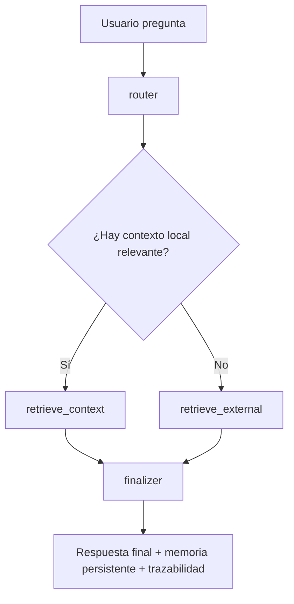
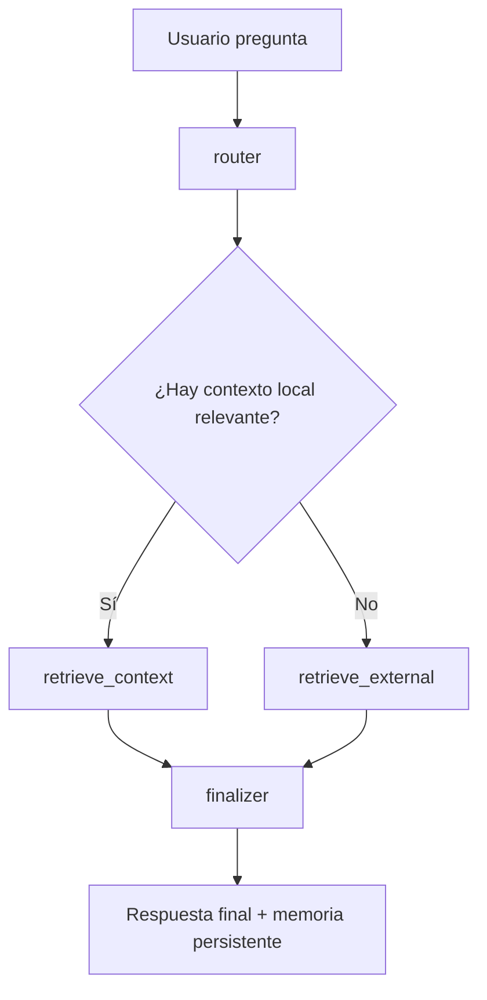

# Daikoku

## Descripción general

Daikoku es un asistente académico inteligente orientado a responder preguntas sobre documentos propios del usuario, combinando recuperación semántica local, memoria contextual y contexto externo. La idea principal es permitir que un estudiante, investigador o docente consulte material académico sin tener que revisar manualmente todo el contenido de un archivo largo.

Este proyecto se define como un caso de uso académico y documental: asistente de consulta para material universitario, apuntes, resúmenes, bibliografía y documentos de estudio. La intención del sistema es apoyar la comprensión del contenido, no reemplazar la lectura crítica de la fuente original.

El sistema integra varias capas:

- ingreso de documentos y textos
- extracción y normalización de contenido
- almacenamiento vectorial local con metadata documental enriquecida
- recuperación por similitud semántica
- orquestación con LangGraph
- memoria de sesión por conversación
- resumen persistente para memoria a largo plazo
- trazabilidad y auditoría del flujo
- respuesta final contextualizada

En su versión actual, el proyecto funciona como un agente RAG (Retrieval-Augmented Generation) con router, recuperación local, recuperación externa y finalización de la respuesta. Este enfoque lo acerca a un patrón de agente profesional con flujo estructurado y decisiones explícitas.

## Estado actual y siguiente paso

La implementación ya consolidó los componentes clave del flujo académico del agente: estado formal con validación, memoria por sesión, router y finalizer, recuperación local y externa, trazabilidad por evento y métricas básicas de calidad de recuperación. Además, el proyecto incorporó la validación de flujo más precisa para rutas externas válidas y un ajuste explícito del finalizador para que la respuesta final esté apoyada por evidencia documental y por el dominio académico definido.

En este momento, el proyecto ya tiene una política de backend definida:

- FAISS se usa como backend vectorial principal cuando está disponible
- Chroma queda como alternativa opcional o experimental
- el backend activo se expone en metadata y observabilidad
- la capa local mantiene un fallback robusto basado en similitud semántica y solapamiento léxico
- la respuesta final incorpora evidencia recuperada y un dominio documental más preciso

El bloque actual de mejora técnica es el benchmark formal y la observabilidad de producción: se requiere comparar resultados por backend, top_k, chunk_size y latencia, y mantener una trazabilidad más formal de cada ejecución del flujo.

En esta etapa, la prioridad es cerrar la madurez operativa del sistema con medición de calidad, métricas reproducibles y validación del comportamiento real del agente bajo distintos escenarios académicos.

---

## Arquitectura formal del agente

La implementación actual está pensada para acercarse a la estructura de un sistema de agentes académico y reproducible, con separación clara entre componentes:

### 1. Estado del grafo

El estado del agente queda definido en `AgentState`, con validación estricta y campos operativos para:

- pregunta del usuario
- ruta seleccionada por el router
- contexto local y externo
- historial de conversación
- resumen de memoria persistente
- `trace_id` para trazabilidad
- `metadata` del flujo de ejecución

Esto formaliza el flujo para que cada nodo reciba un contrato conocido y no dependa de datos inconsistentes.

### 2. Memoria de corto plazo (STM)

La `ShortTermMemory` mantiene el historial reciente de la sesión y evita que la conversación crezca sin control. La memoria activa conserva la continuidad del diálogo más inmediato.

### 3. Memoria de largo plazo (LTM)

La `LongTermMemory` sintetiza el historial pasado en un resumen compacto, lo que permite conservar el contexto conceptual sin saturar la ventana de trabajo del agente. Esto aproxima el comportamiento de una memoria persistente y resumida, muy cercana a la lógica de un sistema más formal y académico.

### 4. Índice vectorial local

El almacenamiento vectorial local en `VectorStore` actúa como índice semántico de documentos. Se distingue claramente entre:

- texto documental original
- metadata asociada al documento
- relevancia calculada por similitud y solapamiento léxico
- resumen de la colección para auditoría y evaluación

Este patrón hace más explícito el modelo de recuperación.

### 5. Trazabilidad y auditoría

Cada decisión del grafo queda registrada en logs con eventos como:

- `router_decision`
- `local_retrieval`
- `external_retrieval`
- `finalizer_output`

Esto permite no solo ejecutar el agente, sino también explicarlo y revisarlo como un sistema observable y verificable.

---

## Diferencia entre routing, retrieval, memory y final answer

### Router

El router decide si la consulta debe dirigirse a contexto local o externo. Esta capa no responde la pregunta; solo elige la estrategia de recuperación más adecuada.

### Retrieval

La capa de recuperación obtiene documentos o fragmentos relevantes. Existen dos tipos principales:

- local: material documentado que ya ha sido ingestado
- externo: información complementaria, en este caso desde Wikipedia

### Memory

La memoria es la capa que preserva el hilo de la conversación. Tiene dos niveles:

- STM: historial acotado y reciente
- LTM: resumen persistente del contexto y las interacciones previas

### Final answer

El `finalizer` es quien sintetiza la respuesta final a partir del contexto recuperado y del estado validado. Su tarea es producir una respuesta útil, contextualizada y consistente con la sesión actual.

---

## Metadata documental enriquecida

Se ha reforzado el uso de metadata documental con campos como:

- `source`
- `title`
- `chunk_id`
- `document_type`
- `ingested_at`

Esto permite que cada fragmento tenga mejor trazabilidad, identificación y explicación dentro del flujo de recuperación semántica.

---

## Módulos principales del agente

El agente está dividido en cuatro bloques funcionales principales:

- `router`: toma la decisión inicial sobre si la consulta debe resolverse con contexto local o externo.
- `retrieve_context`: busca fragmentos relevantes en el corpus del usuario usando similitud semántica.
- `retrieve_external`: consulta una fuente externa, normalmente Wikipedia, para complementar la respuesta cuando la pregunta es conceptual o no está cubierta por el material local.
- `finalizer`: compone la respuesta final, persiste el historial y prepara la salida para el usuario.

Además, el sistema dispone de:

- `VectorStore`: índice local con embeddings y metadata enriquecida
- `AgentState`: estructura formal que valida el flujo entre nodos
- `ShortTermMemory`: historial reciente por sesión
- `LongTermMemory`: resumen persistente de la conversación
- `trace_id`: identificador de auditoría por ejecución
- `generate_answer`: función que compone la respuesta final con contexto recuperado
- `retrieval_mode` y `tool_name`: metadatos explícitos del camino elegido por el router
- `memory_summary`: resumen compacto de la conversación, separado de la memoria activa de corto plazo

---

## Flujo de ejecución

### 1. Carga de documentos

El usuario puede:

- añadir documentos al sistema mediante la API del agente
- usar la interfaz Gradio e ingresar contenido adicional por línea
- invocar `agent.ingest_file()` o `agent.ingest_files()` desde código

### 2. Recuperación local

Cuando el usuario hace una consulta, el sistema:

- transforma la pregunta en un vector
- compara la consulta contra los documentos ya indexados
- selecciona los fragmentos más relevantes

### 3. Enrutamiento

El agente decide si la consulta debe ir por:

- contexto local si hay documentos relevantes
- contexto externo si la pregunta es conceptual o no tiene correspondencia local

Esto se hace en el nodo `router` del grafo de LangGraph.

### 4. Recuperación externa

Si el sistema decide usar contexto externo, consulta la API de Wikipedia en español o inglés y extrae resúmenes breves relevantes para la consulta.

### 5. Finalización

El nodo `finalizer`:

- combina contexto interno + externo
- genera la respuesta final
- agrega la interacción al historial de la sesión
- persiste la memoria resumida y la traza de ejecución

---

## Caso de uso del proyecto

Daikoku está pensado como asistente académico para documentos de estudio, apuntes, textos de referencia y material docente. Su dominio principal es la consulta eficiente sobre documentación académica, no un dominio clínico o empresarial específico.

Esto es importante porque define una especialización real, aunque más general que el ejemplo del profesor: la intención del sistema es servir como agente de estudio y recuperación documental para escenarios universitarios y de investigación.

---

## Observabilidad y trazabilidad en producción

La arquitectura del sistema incluye trazas por evento para mantener observabilidad básica del flujo:

- decisión del router
- contexto local recuperado
- contexto externo recuperado
- finalización de respuesta
- persistencia de sesión

Estas trazas permiten auditar el comportamiento del agente sin necesidad de instrumentar todo el código a mano, y se vuelven útiles al comparar ejecuciones del mismo caso de uso en distintas sesiones.

---

## Evaluación formal de calidad de recuperación

La recuperación semántica debe evaluarse de forma sistemática. Para ello, el proyecto incorpora una mínima batería de validación de calidad a través de evaluaciones de consulta, con métricas como:

- `result_count`
- `top_score`
- `avg_score`
- `relevant`
- `index_summary`

La metodología es útil para comprobar si la recuperación está respondiendo efectivamente a la intención del usuario y si la colección local tiene suficiente calidad para sustentar la respuesta final.

---

## Cómo ejecutar el proyecto

### 1. Crear y activar el entorno virtual

Desde la raíz del proyecto:

```powershell
python -m venv .venv
.\.venv\Scripts\Activate.ps1
```

Si el terminal del editor está en modo Python/REPL y no reconoce comandos de shell, usa esta ruta alternativa desde Python:

```python
import subprocess
py = r"C:\Users\admin\Documents\GitHub\Daikoku\.venv\Scripts\python.exe"
subprocess.run([py, "-m", "pip", "install", "-r", "requirements.txt"], cwd=r"C:\Users\admin\Documents\GitHub\Daikoku")
```

### 2. Instalar dependencias

```powershell
pip install -r requirements.txt
```

### 3. Ejecutar la suite de pruebas

```powershell
python -m unittest tests.test_daikoku -q
```

Si el terminal del editor falla, usa esta ejecución desde Python:

```python
import subprocess
py = r"C:\Users\admin\Documents\GitHub\Daikoku\.venv\Scripts\python.exe"
subprocess.run([py, "-m", "unittest", "tests.test_daikoku", "-q"], cwd=r"C:\Users\admin\Documents\GitHub\Daikoku")
```

### 4. Ejecutar un ejemplo básico del agente

```python
from src.agente import DaikokuAgent

agent = DaikokuAgent()
agent.add_documents([
    "Neural networks learn patterns from data using layers and weights.",
    "Machine learning uses examples to detect patterns and make predictions.",
])

print(agent.answer("What are neural networks?", session_id="demo_session"))
```

### 5. Nota sobre el terminal en VS Code

Si el terminal activo del editor parece interpretar comandos como Python en vez de shell, se recomienda abrir una terminal nueva en PowerShell o ejecutar la misma lógica con `subprocess` desde Python. Esa ruta es más fiable en esta sesión.

---

## Diagrama del flujo general del sistema



---

## Estructura del repositorio

```text
Daikoku/
├── README.md
├── requirements.txt
├── src/
│   ├── agente.py
│   ├── embeddings.py
│   ├── generacion.py
│   ├── ingesta.py
│   └── retrieval.py
├── tests/
│   ├── test_daikoku.py
│   └── ejemplos/
│       └── preguntas_prueba.txt
├── docs/
│   ├── benchmark_retrieval.md
│   ├── observabilidad_produccion.md
│   └── (material de apoyo del proyecto)
└── .venv/   (si se crea localmente)
```

---

## Validación y pruebas

La validación del sistema se realiza con pruebas unitarias y de integración automatizadas en `tests/test_daikoku.py`. Estas pruebas cubren el flujo completo del agente y sirven como evidencia de que cada componente funciona de forma consistente en condiciones reales.

### Benchmark formal y comparativo

El proyecto incluye evaluaciones comparativas para:

- backend activo: `compare_backends(...)`
- top_k: `compare_top_k(...)`
- tamaños de chunk: `compare_chunk_sizes(...)`
- consultas repetidas: `benchmark_retrieval(...)`

Estas comparaciones permiten medir calidad, latencia y estabilidad del índice con la misma batería de consultas del dominio académico.

### Observabilidad de producción

El flujo del agente registra trazas por sesión mediante `trace_id` y `session_id`, junto con eventos en cada nodo del grafo. Esto permite verificar la ruta elegida por el router, la fuente del contexto, la memoria usada y la respuesta final generada.

La documentación de observabilidad se encuentra en [docs/observabilidad_produccion.md](docs/observabilidad_produccion.md).

### Casos validados

---

## Objetivo del proyecto

El proyecto busca ayudar a usuarios a comprender documentos complejos mediante un asistente que:

- responde preguntas sobre documentos cargados
- identifica contenido relevante dentro del material
- recupera información complementaria desde Wikipedia cuando la consulta lo requiere
- mantiene historial de la conversación por sesión
- ofrece una interfaz simple para usar el sistema sin necesidad de programación

---

## Casos de uso

Daikoku es útil para:

- estudiantes revisando apuntes, PDFs o resúmenes
- docentes buscando conceptos clave en material de clase
- usuarios que quieren consultar información sin leer todo el documento
- prototipos académicos de sistemas de IA orientados a documentación

---

## Arquitectura del sistema

El proyecto está estructurado en capas funcionales:

1. Interfaz de usuario

   - Gradio
   - Permite enviar preguntas e interactuar con el agente
2. Capa de ingreso de información

   - Documentos y texto libre
   - Se almacenan y luego se indexan para recuperación
3. Capa de extracción y normalización

   - `src/ingesta.py`
   - Convierte textos de entrada en chunks procesables
4. Capa de embeddings y similitud

   - `src/embeddings.py`
   - Genera vectores de representación del texto
   - Calcula similitud por coseno
5. Capa de almacenamiento vectorial

   - `src/retrieval.py`
   - Mantiene una colección local de documentos con embeddings
   - Permite buscar el contenido más similar a una consulta
6. Capa de orquestación del agente

   - `src/agente.py`
   - Implementa un flujo con LangGraph
   - Tiene un router, recuperación local, recuperación externa y finalizer
7. Capa de generación de respuesta

   - `src/generacion.py`
   - Produce la respuesta final usando el contexto recuperado
8. Persistencia de sesión

   - Se guarda historial de conversación por `session_id`
   - Permite continuidad dentro de la misma sesión

---

## Flujo de ejecución

### 1. Carga de documentos

El usuario puede:

- añadir documentos al sistema mediante la API del agente
- usar la interfaz Gradio e ingresar contenido adicional por línea
- invocar `agent.ingest_file()` o `agent.ingest_files()` desde código

### 2. Recuperación local

Cuando el usuario hace una consulta, el sistema:

- transforma la pregunta en un vector
- compara la consulta contra los documentos ya indexados
- selecciona los fragmentos más relevantes

### 3. Enrutamiento

El agente decide si la consulta debe ir por:

- contexto local si hay documentos relevantes
- contexto externo si la pregunta es conceptual o no tiene correspondencia local

Esto se hace en el nodo `router` del grafo de LangGraph.

### 4. Recuperación externa

Si el sistema decide usar contexto externo, consulta la API de Wikipedia en español o inglés y extrae resúmenes breves relevantes para la consulta.

### 5. Finalización

El nodo `finalizer`:

- combina contexto interno + externo
- genera la respuesta final
- agrega la interacción al historial de la sesión

---

## Módulos principales del agente

El agente está dividido en cuatro bloques funcionales principales:

- `router`: toma la decisión inicial sobre si la consulta debe resolverse con contexto local o externo.
- `retrieve_context`: busca fragments relevantes en el corpus del usuario usando similitud semántica.
- `retrieve_external`: consulta una fuente externa, normalmente Wikipedia, para complementar la respuesta cuando la pregunta es conceptual o no está cubierta por el material local.
- `finalizer`: compone la respuesta final, persiste el historial y prepara la salida para el usuario.

Además, el sistema dispone de:

- `VectorStore`: índice local con embeddings y metadata
- `AgentState`: estructura formal que valida el flujo entre nodos
- `session_memory`: historial persistente por `session_id`
- `generate_answer`: función que compone la respuesta final con contexto recuperado
- `retrieval_mode` y `tool_name`: metadatos explícitos del camino elegido por el router, para hacer el flujo más auditable
- `memory_summary`: resumen compacto de la conversación, separado de la memoria activa de corto plazo

La diferencia entre memoria activa y resumen persistente se hace explícita para alinear el proyecto con el enfoque académico del profesor: el historial corto conserva el hilo reciente, mientras que el resumen sirve como memoria de contexto más estable y compacta.

---

## Conceptos clave del sistema

### ¿Qué es un RAG?

Un RAG (Retrieval-Augmented Generation) es un patrón de IA en el que el modelo no responde solo desde su conocimiento interno, sino que primero recupera información relevante de una fuente externa y luego genera la respuesta utilizando esa evidencia.

En Daikoku, esto se usa para:

- responder con base documental real
- reducir alucinaciones
- aprovechar el material del usuario y, si hace falta, información externa
- mantener la respuesta anclada a fuentes verificables

### ¿Qué es un embedding?

Un embedding es una representación numérica de un texto que captura su significado en un espacio vectorial. Dos textos con significados parecidos suelen estar cerca en ese espacio.

En este proyecto, los embeddings sirven para:

- convertir preguntas y chunks en vectores
- comparar consultas con documentos almacenados
- recuperar los fragmentos más similares por semántica, no solo por palabras exactas

### ¿Qué es el router y por qué es importante?

El router es el nodo encargado de decidir el camino que seguirá la consulta dentro del grafo. Es importante porque evita que el agente haga siempre lo mismo y permite separar dos tipos de evidencia:

- local: documentos cargados por el usuario
- externo: fuentes complementarias como Wikipedia

Esto mejora la calidad, la trazabilidad y la comprensión del flujo del agente.

### ¿Qué es la memoria del agente?

La memoria del agente permite mantener el contexto de la conversación entre interacciones. En este proyecto, la memoria se guarda por sesión usando un identificador único (`session_id`) y se mantiene persistente en disco en la carpeta `data/sessions`.

Su objetivo es:

- conservar el hilo de la conversación
- reutilizar contexto histórico
- evitar repetir preguntas sin tener en cuenta la interacción previa
- limitar el historial para que no crezca indefinidamente

### ¿Qué es la herramienta externa y por qué se usa?

La herramienta externa es la consulta a Wikipedia. Se usa cuando la consulta es conceptual, muy general o no tiene suficiente cobertura en el corpus local. Esto permite enriquecer la respuesta con definiciones o explicaciones generales sin depender únicamente del material subido por el usuario.

----

## Diagrama del flujo general del sistema



El flujo puede resumirse así:

1. el usuario hace una pregunta
2. el `router` decide si la respuesta requiere contexto local, externo o ambos
3. la capa de recuperación obtiene los documentos o fragmentos más relevantes
4. el `finalizer` genera la respuesta final y guarda el historial en sesión

---

## Estructura del repositorio

```text
Daikoku/
├── README.md
├── requirements.txt
├── main.py
├── docs/
│   └── (material de apoyo del proyecto)
├── src/
│   ├── agente.py
│   ├── embeddings.py
│   ├── generacion.py
│   ├── ingesta.py
│   └── retrieval.py
├── tests/
│   ├── test_daikoku.py
│   └── ejemplos/
│       └── preguntas_prueba.txt
└── .venv/   (si se crea localmente)
```

### Descripción de archivos clave

- `main.py`: punto de entrada de la interfaz Gradio
- `src/agente.py`: lógica del agente, router, finalizer, memoria y LangGraph
- `src/retrieval.py`: sistema de búsqueda vectorial local
- `src/embeddings.py`: generación de embeddings y similitud
- `src/generacion.py`: construcción de respuesta final
- `src/ingesta.py`: preparación y extracción de texto
- `tests/test_daikoku.py`: validaciones funcionales del proyecto

---

## Validación y pruebas

La validación del sistema se realiza con pruebas unitarias y de integración automatizadas en `tests/test_daikoku.py`. Estas pruebas cubren el flujo completo del agente y sirven como evidencia de que cada componente funciona de forma consistente en condiciones reales.

### Casos validados

- Lógica del router: comprueba que la decisión de ruta siga una política clara entre contexto local y externo.
- Comportamiento sin contexto local: confirma que el agente responde sin romper el flujo cuando no hay documentos indexados.
- Comportamiento con contexto local: valida que la recuperación semántica devuelve contenido útil y genera una respuesta basada en el corpus del usuario.
- Comportamiento con contexto externo: comprueba que la búsqueda externa es accesible y produce resultados normalizados para complementar la respuesta.
- Memoria por sesión: comprueba que el historial se persiste y se mantiene acotado por sesión.
- Repetición y continuidad: asegura que la respuesta repetida y la conversación histórica se comportan de forma coherente.
- Caso de error o respuesta vacía: valida que la entrada vacía o ambigua devuelve un mensaje útil y no rompe la ejecución.
- Documentación de pruebas: cada caso se mantiene en el informe y en los tests para dejar trazabilidad del comportamiento del sistema.

Estas comprobaciones se ejecutan con:

```bash
python -m unittest tests.test_daikoku -q
```

> El proyecto mantiene una política de validación por evidencia: se considera correcta una funcionalidad cuando la prueba real del flujo pasa y no rompe la ejecución del agente.

---

## Requisitos

### Requisitos mínimos

- Python 3.10 o superior
- Internet para consultas a Wikipedia
- Acceso a consola o terminal
- Dependencias del proyecto (se instalan desde `requirements.txt`)

### Dependencias principales

El proyecto usa:

- `gradio`
- `requests`
- `langgraph`
- `langchain`
- `langchain-core`
- `markitdown`
- `pypdf`
- `sentence-transformers`
- `pytest`/`unittest` para validaciones

La lista completa puede verse en [requirements.txt](requirements.txt).

---

## Instalación

### 1. Clonar el repositorio

```bash
git clone <url-del-repositorio>
cd Daikoku
```

### 2. Crear entorno virtual

En Windows PowerShell:

```powershell
python -m venv .venv
.\.venv\Scripts\Activate.ps1
```

Si aparece este error:

```powershell
No se puede cargar el archivo ...\Activate.ps1 porque la ejecución de scripts está deshabilitada en este sistema
```

significa que la política de ejecución de PowerShell está bloqueando scripts. Para activar el entorno solo para la sesión actual, ejecuta:

```powershell
Set-ExecutionPolicy -Scope Process -ExecutionPolicy Bypass
.\.venv\Scripts\Activate.ps1
```

Esto permite ejecutar scripts temporalmente sin cambiar la política global del sistema.

En Linux/macOS:

```bash
python -m venv .venv
source .venv/bin/activate
```

### 3. Instalar dependencias

En la mayoría de entornos Windows, la forma más fiable es usar el intérprete de Python del entorno virtual en lugar de invocar `pip.exe` directamente:

```powershell
.\.venv\Scripts\python.exe -m pip install --upgrade pip
.\.venv\Scripts\python.exe -m pip install -r requirements.txt
```

Esto evita bloqueos de seguridad asociados a `pip.exe` en sistemas con políticas de aplicación o AppLocker.

> En algunos entornos Windows puede requerirse instalar con permisos adicionales o usar la ruta del ejecutable de Python del sistema. El proyecto fue validado en un entorno con Python 3.14.

### 4. Solución rápida para errores de seguridad en Windows

Si aparece este mensaje:

```powershell
Error al ejecutar el programa 'pip.exe': Una directiva de Control de aplicaciones bloqueó este archivo
```

la causa es la política de seguridad del equipo, no el proyecto. La solución recomendada es usar el intérprete de Python como referencia:

```powershell
.\.venv\Scripts\python.exe -m pip install -r requirements.txt
```

Si además se bloquea la activación del entorno:

```powershell
Set-ExecutionPolicy -Scope Process -ExecutionPolicy Bypass
.\.venv\Scripts\Activate.ps1
```

---

## Ejecución del proyecto

### Ejecutar la interfaz Gradio

```bash
python main.py
```

o, si estás usando el entorno virtual creado manualmente:

```powershell
.\.venv\Scripts\python.exe main.py
```

Esto levantará la interfaz del agente en el navegador. El usuario podrá:

- escribir preguntas
- añadir documentos o fragmentos adicionales
- interactuar con el sistema en una sesión compartida

### Ejecutar pruebas

```bash
python -m unittest tests.test_daikoku -q
```

o:

```powershell
.\.venv\Scripts\python.exe -m unittest tests.test_daikoku -q
```

---

## Prompts de prueba

A continuación, algunos ejemplos de preguntas para validar el comportamiento del sistema con documentos académicos o de estudio.

### Preguntas generales

```text
¿De qué trata este documento?
¿Qué es un modelo de redes neuronales?
Resume en pocas palabras la idea principal del contenido.
Explica este concepto de forma sencilla.
¿Hay alguna definición clara de este tema?
```

### Preguntas orientadas a recuperación local

```text
¿Cuál es la diferencia entre machine learning y deep learning?
¿Qué mencionan los documentos sobre redes neuronales?
¿Dónde se habla del concepto principal del texto?
¿Qué ideas clave aparecen en el material?
¿Puedes resumir los puntos más relevantes?
```

### Preguntas de validación de memoria

```text
¿Qué acabamos de discutir?
Repite la respuesta anterior en una versión más breve.
¿Puedes explicarlo con un ejemplo?
```

### Preguntas para activar contexto externo

```text
¿Qué es una red neuronal?
Define aprendizaje automático.
¿Quién fue el creador de la inteligencia artificial moderna?
¿Qué es un concepto clave relacionado con este tema?
```

Estas preguntas permiten comprobar que el agente:

- recupera información del corpus local
- usa contexto externo cuando es necesario
- mantiene memoria en la misma sesión
- responde en un estilo útil para estudio y consulta académica

---

## Uso desde Python

También puede instanciar el agente directamente desde código:

```python
from src.agente import DaikokuAgent

agent = DaikokuAgent()
agent.add_documents([
    "Neural networks are computational models inspired by biological brains.",
    "Machine learning uses algorithms to detect patterns from examples."
])

respuesta = agent.answer("What are neural networks?", session_id="session_1")
print(respuesta)
```

También puede recuperar contexto externo manualmente:

```python
from src.agente import DaikokuAgent

agent = DaikokuAgent()
print(agent.buscar_contexto_externo("machine learning", top_k=2))
```

---

## Modo de funcionamiento del agente

El agente actual trabaja con un patrón de flujo tipo LangGraph:

```text
router
  ├── retrieve_context  → finalizer
  └── retrieve_external → finalizer
```

### Nodo router

Decide si la consulta debe resolverse:

- con documentos locales del sistema
- con un contexto externo adicional

### Nodo retrieve_context

Busca los textos semánticamente más similares en la base local.

### Nodo retrieve_external

Consulta Wikipedia para complementar la respuesta.

### Nodo finalizer

Genera la respuesta final y preserva la memoria de la sesión.

---

## Memoria persistente por sesión

El agente mantiene un historial por `session_id`:

```python
agent.answer("¿Qué es aprendizaje automático?", session_id="alumno_1")
agent.answer("Repite la respuesta anterior", session_id="alumno_1")
```

Esto permite que el sistema conserve el contexto de la conversación dentro de la misma sesión sin necesidad de resolverla desde cero.

---

## Variables de entorno y configuración

El proyecto admite una opción para activar embeddings semánticos más potentes si se desea utilizar una implementación basada en `sentence-transformers`:

```bash
set DAIKOKU_USE_SEMANTIC_MODEL=true
```

En PowerShell:

```powershell
$env:DAIKOKU_USE_SEMANTIC_MODEL = "true"
```

Esto activa el modelo semantic sentence-transformer cuando está disponible. Si no se configura, el sistema usa una estrategia de vectorización local basada en conceptos básicos para funcionar sin depender de modelos pesados.

---

## Limitaciones actuales

El proyecto es un prototipo técnico funcional con varios puntos relevantes a considerar:

- la generación de respuestas es ligera y orientada a contexto
- no depende de un proveedor externo de LLM para funcionar, aunque puede extenderse fácilmente
- la recuperación externa utiliza Wikipedia pública y requiere conexión a Internet
- el almacenamiento local es in-memory por defecto, no persistente en base de datos externa
- la extracción de documentos es útil para prototipos y uso académico básico

---

## Extensiones recomendadas

Entre mejoras futuras destacan:

- persistencia de historial en SQLite o archivos JSON
- integración con OpenAI, Azure OpenAI, GitHub Models u otros proveedores
- soporte más completo para PDFs, Word y Excel
- carga de múltiples documentos desde una carpeta
- mejoras en la limpieza y chunking de textos largos
- despliegue web con FastAPI o Streamlit

---

## Validación

El proyecto cuenta con pruebas funcionales en:

- `tests/test_daikoku.py`

Se verifican elementos como:

- recuperación local
- manejo de sesión
- agente con flujo de respuesta
- integración de contexto externo

Comando de validación:

```bash
python -m unittest tests.test_daikoku -q
```

---

## Resumen ejecutivo

Daikoku es un proyecto de asistente académico basado en RAG y LangGraph, pensado para responder preguntas sobre documentos del usuario con un enfoque práctico y docente. Su principal fortaleza es combinar:

- recuperación local semántica
- enrutamiento inteligente
- contexto externo de Wikipedia
- memoria de sesión
- interfaz simple con Gradio

Esto convierte al proyecto en una base sólida para aplicaciones de IA orientadas a documentación, educación y soporte de análisis de contenidos complejos.

---

## Licencia y uso

Este proyecto se entrega como base académica y técnica para investigación, aprendizaje y desarrollo. Puede ser reutilizado y extendido conforme a la intención del proyecto y la normativa de uso del entorno en el que se despliegue.
